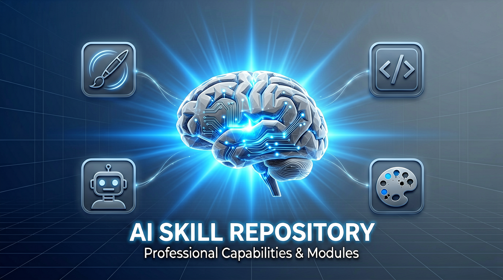
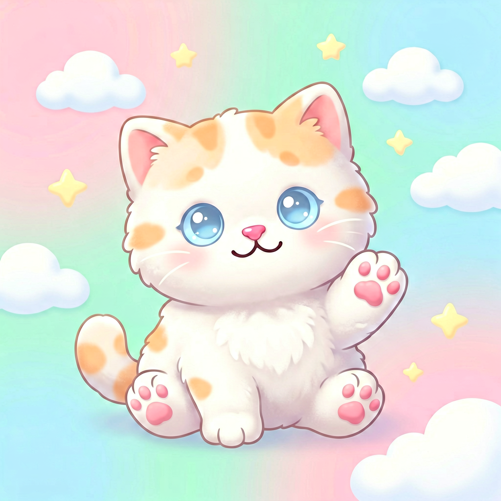

# 技能仓库



本仓库存放我所有的自定义技能，每个技能用于增强 Claude、Codex等智能体的特定能力。

## 技能列表

### 1. ernie-image - 百度文心图片生成技能

基于百度飞桨 AI Studio 星河社区的 ERNIE-Image-Turbo 模型，实现文字生成图片。支持多种风格和色系选择，可生成高质量的AI绘画作品。

#### 功能特点
- 🎨 **17种风格可选**：写实摄影、水彩插画、油画、二次元、赛博朋克、中国风水墨、像素风、扁平插画、3D渲染、吉卜力、蒸汽朋克、极简主义、PPT商务风、可爱卡通风、国潮风、科技蓝调风、温暖治愈风
- 🌈 **7大色系可选**：蓝灰科技系、马卡龙清新系、国潮红金系、黑白极简系、暖橙治愈系、森林自然系、赛博霓虹系
- 📐 **7种尺寸比例**：支持从1:1到16:9的各种常用尺寸
- 🎯 **智能引导强度**：根据风格自动匹配最佳引导强度参数

#### 使用场景
- AI绘画、插画创作
- 海报设计、头像生成
- PPT配图、技术方案架构图
- 产品展示、概念图可视化

#### 生成效果示例

| 风格 | 色系 | 示例 |
|------|------|------|
| 可爱卡通风 | 马卡龙清新系 |  |

#### 配置说明
使用前需要先配置百度文心API Token：
1. 访问 [https://aistudio.baidu.com/account/accessToken](https://aistudio.baidu.com/account/accessToken) 获取 Access Token
2. 在 `.claude/skills/ernie-image/` 目录下将 `.env.example` 复制为 `.env`
3. 将获取的 Token 填入 `AISTUDIO_API_KEY` 配置项

#### 调用方式
```
/ernie-image 生成一只可爱的小猫咪
```

#### 工作流程
1. 选择图片风格（推荐3-5个合适的风格）
2. 选择色系配色（推荐3-4个合适的色系）
3. 确认图片尺寸（根据场景智能推荐）
4. 根据风格自动设置引导强度
5. 调用文心API生成图片
6. 返回结果并展示保存路径

---

*更多技能待添加...*


## License

MIT
